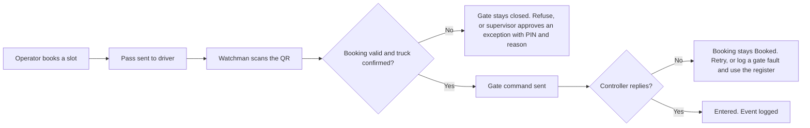
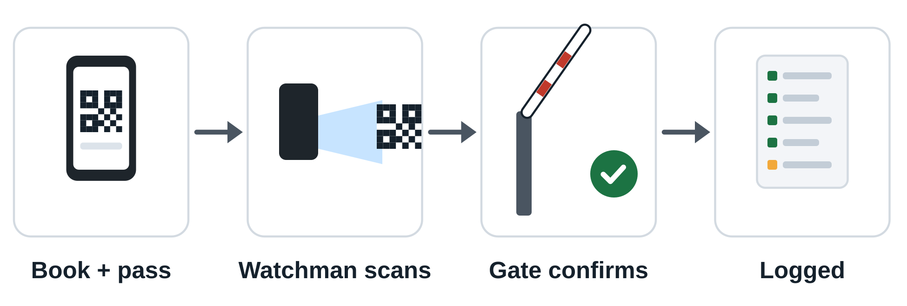
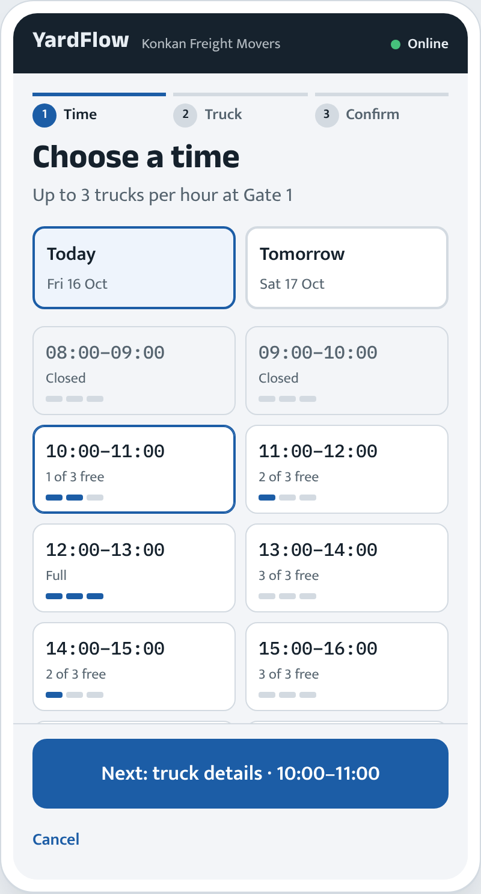
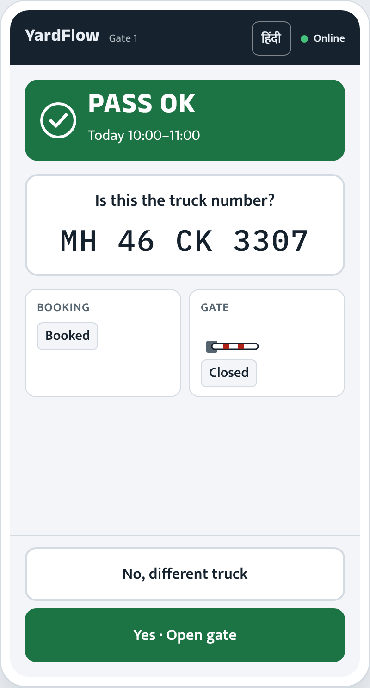

# YardFlow

Book a container-yard slot, send the driver a pass, check the truck at the gate, and bill from actual storage time. A product case study with a clickable prototype.

**Status:** interactive prototype · demo data · no backend · no hardware connected
**Try it:** [live demo](https://yardflow-three.vercel.app/yardflow-prototype%20%281%29.html), or open [`yardflow-prototype (1).html`](yardflow-prototype%20%281%29.html) in any browser.

## The problem

When booking and gate entry don't share data, gate staff can't quickly and reliably confirm that an arriving truck holds a valid booking. Trucks are waved in on trust, or turned away in arguments.

## Who it's for

| User | What they need |
|---|---|
| **Gate watchman** | One clear answer per truck, in big text, in Hindi or English, and a safe next step when the system fails. Used outdoors, standing, with one hand on a phone. |
| **Transport operator** | To send a truck knowing it will be accepted: a fixed entry hour and a pass that works at the gate. |
| **Yard supervisor** | To see exceptions, arrivals and what is in storage, and to bill from actual storage time. |

## Original prototype vs this repository

This repository is **not** the original project. The prototype's own "What is original and what is proposed" panel states the split, and it is repeated here.

| | Original prototype | This repository |
|---|---|---|
| What it covered | Slot booking, gate staff scanning a QR with a phone, a booking check, ESP32 gate control | A single-file interactive prototype of the idea, plus proposed extensions |
| Status | Demonstrated, never deployed, **code lost** | Rebuilt as a case study with demo data |
| Hardware | ESP32 controlled the gate | **None.** Gate opening, controller replies and the QR are simulated |
| Added here (proposed) | | Multi-yard search, duration-based storage, English/Hindi booking, configurable tariffs, storage lifecycle, exit billing |

Yards, prices, people, trucks and containers are invented. Tariff structures follow published Indian CFS/ICD/terminal schedules, and the amounts are illustrative.

## What the prototype demonstrates

The prototype has three views, switched from the top bar.

- **Book (operator).** Find yards that fit a container, see each yard's rules and an estimated charge before booking, and send the pass to the driver.
- **Gate (watchman).** Check the booking, confirm the truck and container numbers with a yes/no question, then open the gate (simulated). Refusals keep the gate closed. English and Hindi.
- **Yard dashboard (supervisor).** Exceptions to review, expected arrivals, trucks entered and waiting, trucks in storage, collected and billed, an event history per booking, and a demo tariff configuration.

A demo panel lets you move the clock forward, take the server offline, make the gate controller stop replying, and reset the data. That is how the failure paths below can be tried.

## Core loop

The same loop from the case-study deck:

## Product decisions

- **A yes/no truck-number check before the gate opens.** A QR proves a booking, not the truck.
- **Booking status and gate status are shown separately.** A booking becomes *Entered* only when the gate controller confirms.
- **Refusal screens never show an open button.**
- **Software never opens the gate on doubt.** If the server is down or the controller is silent, staff fall back to the register book and entries are reconciled later.

## Case-study screens

These come from the YardFlow case-study deck and show the core loop (a single yard with hourly slots). The interactive prototype extends this flow, so its screens differ.

| Choose a time | Is this the truck? |
|---|---|
|  |  |

## Tech stack

Plain HTML, CSS and JavaScript in one file. No build step, no dependencies, no network calls. Fonts (Anek Devanagari, Mukta, IBM Plex Mono) load from Google Fonts and fall back to system fonts offline.

## Run it locally

1. Download or clone the repository.
2. Open `yardflow-prototype (1).html` in a browser.

There is nothing to install and nothing to configure.

## Limitations and next steps

- All data lives in the page and resets on reload. There is no backend, login or database.
- The QR, gate controller and notifications are simulated. The original ESP32 gate control is not part of this repository.
- Yards and tariffs are invented. The prototype has not been tested with real gate staff or operators.
- Next: validate the gate flow with real watchmen, and decide what a real gate-controller integration would need before building one.
